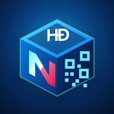
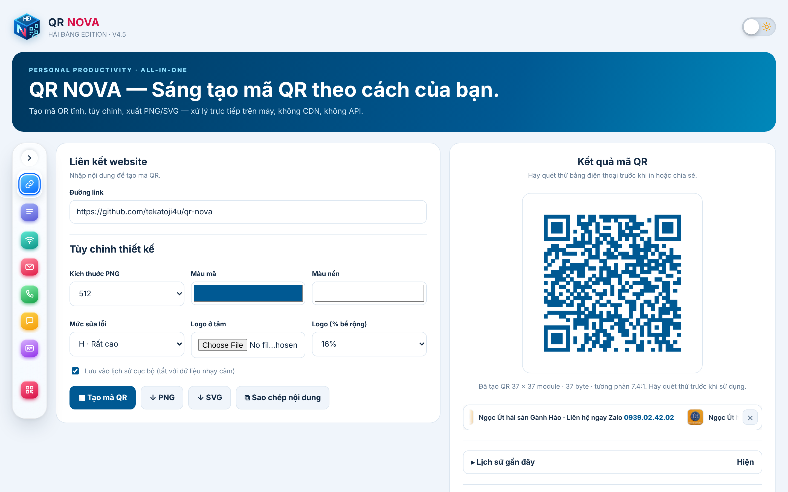
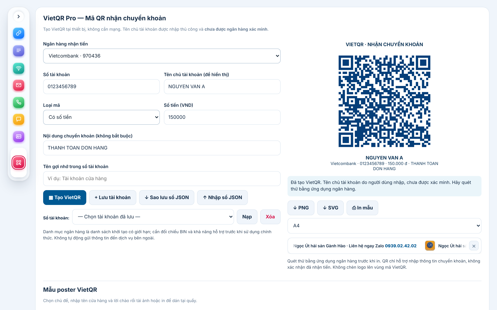
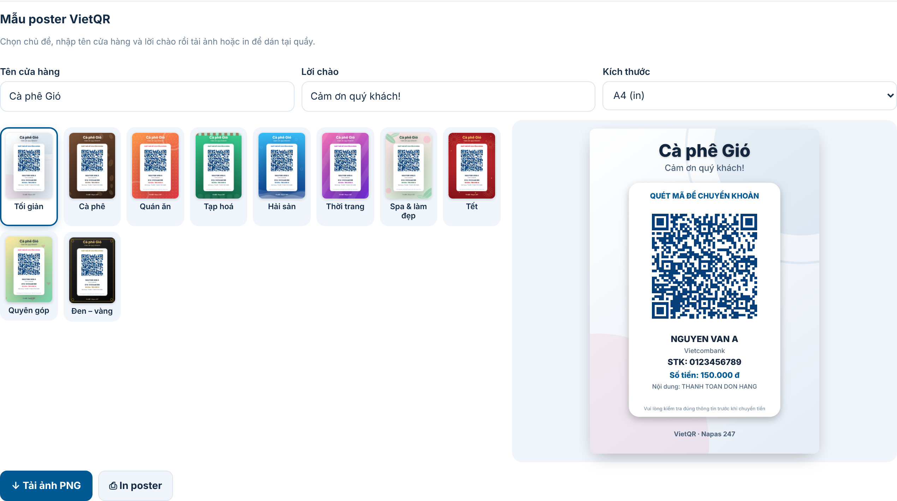
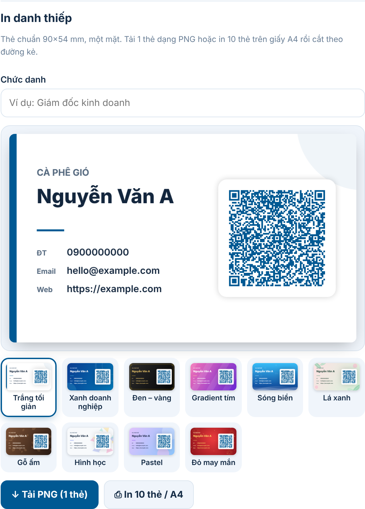
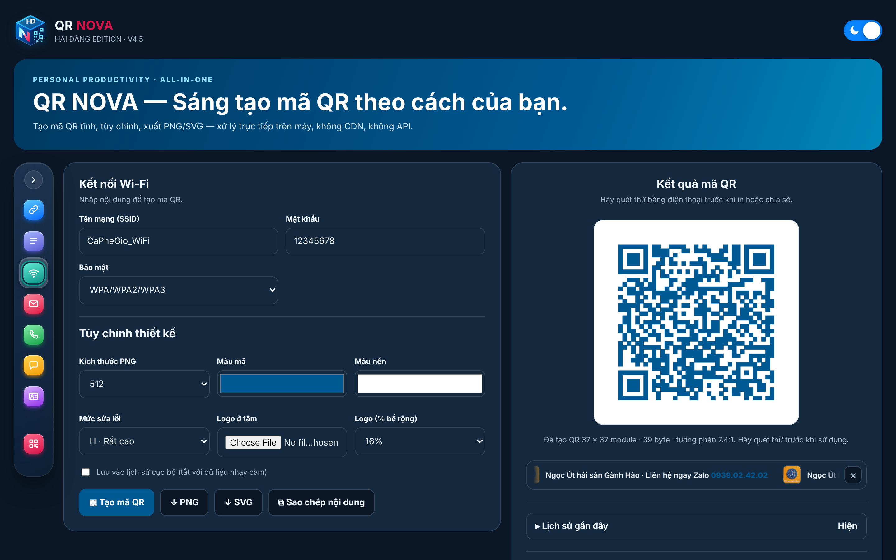
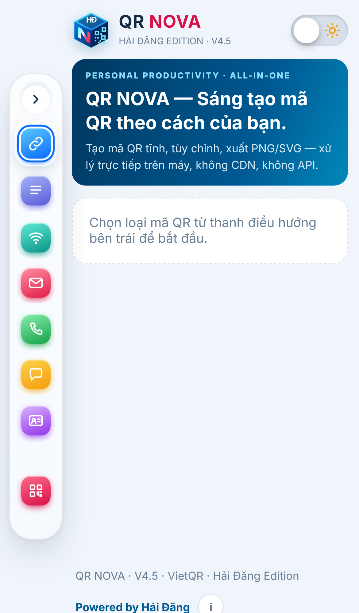
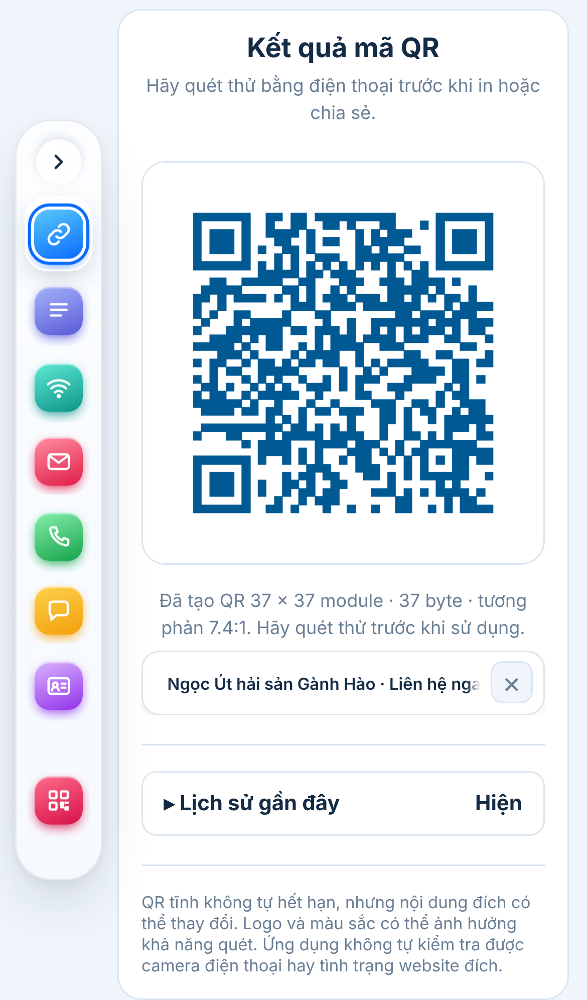

  

<h1 align="center">QR NOVA</h1>

<b>Sáng tạo mã QR theo cách của bạn.</b> 
Công cụ tạo mã QR tĩnh và VietQR nhận chuyển khoản, chạy hoàn toàn trong trình duyệt, chỉ với một tệp HTML.

## Giới thiệu

QR Nova là ứng dụng web gói gọn trong một tệp `index.html`. Mở tệp là dùng được ngay: không cần cài đặt, không cần tài khoản, không gọi máy chủ, CDN hay API bên ngoài. Mọi dữ liệu bạn nhập đều được xử lý ngay trên thiết bị.

## Tính năng chính

### 7 loại mã QR thông dụng

Chọn loại mã từ thanh điều hướng bên trái:

| Loại | Nội dung |
| --- | --- |
| Liên kết | Đường dẫn website |
| Văn bản | Đoạn văn bản tự do |
| Wi-Fi | Tên mạng, mật khẩu và kiểu bảo mật để khách quét là kết nối |
| Email | Địa chỉ nhận, tiêu đề và nội dung |
| Điện thoại | Số điện thoại để gọi nhanh |
| SMS | Số điện thoại kèm tin nhắn soạn sẵn |
| Danh thiếp | vCard gồm họ tên, tổ chức, số điện thoại, email, website |

### Tùy chỉnh thiết kế

- Kích thước ảnh PNG: 256, 512, 1024 hoặc 2048 px.
- Đổi màu mã và màu nền, ứng dụng tự báo độ tương phản.
- Chọn mức sửa lỗi L, M, Q hoặc H.
- Chèn logo vào giữa mã với kích thước 12%, 16% hoặc 20%.
- Xuất ảnh **PNG**, **SVG** (vector) hoặc sao chép nội dung mã.
- Lưu lịch sử gần đây trên trình duyệt, có thể tắt khi nhập dữ liệu nhạy cảm, kèm sao lưu và khôi phục bằng tệp JSON.

### VietQR Pro: mã QR nhận chuyển khoản

- Hỗ trợ hơn 20 ngân hàng phổ biến (Vietcombank, VietinBank, BIDV, Agribank, MB, Techcombank, ACB, Vikki Bank...).
- Tạo mã không cố định số tiền hoặc có sẵn số tiền và nội dung chuyển khoản.
- Sổ tài khoản: lưu nhiều tài khoản để nạp lại nhanh, sao lưu và nhập sổ bằng JSON.
- Tải PNG, SVG hoặc in mẫu theo khổ A4, A5 hoặc thẻ QR.

### Poster VietQR dán tại quầy

- 10 chủ đề: Tối giản, Cà phê, Quán ăn, Tạp hoá, Hải sản, Thời trang, Spa & làm đẹp, Tết, Quyên góp, Đen – vàng.
- Thêm tên cửa hàng và lời chào.
- Nhiều kích thước: A4, A5, 10×15 cm, ảnh vuông 1080×1080 và ảnh dọc 1080×1920 để đăng mạng xã hội.
- Tải ảnh PNG hoặc in trực tiếp.

### In danh thiếp có mã QR

- Thẻ chuẩn 90×54 mm, tự lấy thông tin từ mã Danh thiếp.
- 10 mẫu nền: Trắng tối giản, Xanh doanh nghiệp, Đen – vàng, Gradient tím, Sóng biển, Lá xanh, Gỗ ấm, Hình học, Pastel, Đỏ may mắn.
- Tải PNG một thẻ hoặc in 10 thẻ trên một trang A4 rồi cắt theo đường kẻ.

### Giao diện dễ dùng

- Thanh điều hướng dạng kính mờ với biểu tượng màu, mặc định thu gọn thành dải biểu tượng để nhường chỗ cho nội dung.
- Công tắc chế độ sáng và tối.
- Tự co giãn cho điện thoại, máy tính bảng và máy tính.
- Thêm vào màn hình chính iPhone với biểu tượng riêng.

| Chế độ tối | Trên điện thoại |
| --- | --- |
|  |   |

## Cách sử dụng

1. Tải về `index.html` (kèm `apple-touch-icon.png`, thư mục `icons/` và `manifest.webmanifest` nếu muốn có biểu tượng trên màn hình chính).
2. Mở `index.html` bằng trình duyệt bất kỳ, hoặc đưa các tệp lên một host tĩnh như GitHub Pages.
3. Chọn loại mã ở thanh bên trái, nhập nội dung, tùy chỉnh rồi bấm **Tạo mã QR**.
4. Quét thử bằng điện thoại trước khi in hoặc chia sẻ.

## Công nghệ

- HTML5, CSS3 và JavaScript thuần, không framework.
- Thư viện tạo QR được nhúng trực tiếp trong tệp HTML.
- Canvas API để dựng ảnh PNG, poster và danh thiếp; SVG để xuất mã vector.
- localStorage để lưu lịch sử, sổ tài khoản và tùy chọn giao diện.

## Lưu ý

- Mã QR tĩnh không tự hết hạn, nhưng trang đích có thể ngừng hoạt động.
- Tên chủ tài khoản trong VietQR do người dùng nhập và chưa được ngân hàng xác minh. Hãy quét thử bằng ứng dụng ngân hàng trước khi in.
- Không đưa thông tin mật vào mã QR công khai.

## Liên hệ

Tác giả: **Huỳnh Hải Đăng**. Hoan nghênh góp ý cải tiến giao diện, chức năng và báo lỗi khi sử dụng.

---

**Powered by Hải Đăng**
